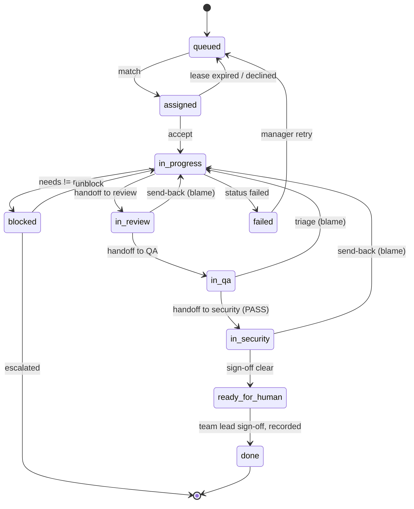
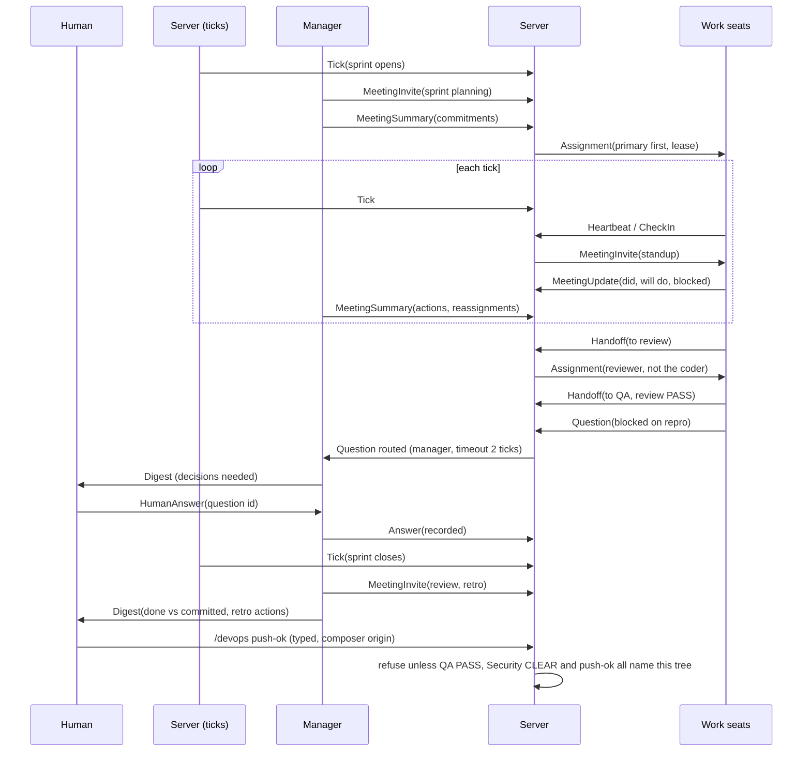

<!-- docs-new: orchestrator (server, team lead, seat profile, envelopes; design, partly built) -->
# Orchestrator and management layer: design

Status: design, partly built. Built in this stack: the store (phase 2), work
items (phase 4, with the item's job from phase 5) and team boards (phase 12).
The other phases are design only; their first code was removed as unused and
is not planned yet.

Read the schemas in `docs/schemas/envelopes.schema.json`. The envelopes
below are the wire format; this document says what they mean.

The Done chain's signature items (merge-ok, merge-deny, done, the BA's
scan, the merge report and the client's decision) are `chain.signature`
envelopes (`Signature`), recorded on the board by
`scripts/devops-scrum.mjs`; see references/scrum-meetings.md, Done.

## Terms

- **Manager** means the team lead: the seat that plans sprints, sets
  commitments, runs meetings and escalates. It is a seat, not the human. It
  holds no approval authority and never pushes or changes a gate.
- **Human** is the person who approves pushes (`/devops push-ok`) and answers
  decisions only they can make.

## 0. Roles

Placement: the server runs outside any seat and counts ticks itself. There is
no clock seat. A seat may be one agent or several; a seat of one agent is still
a seat, and every rule that says "another seat" applies to it. The server
writes no code and reviews no work.

Two rules hold throughout: management plans, and serving routes. The
server never plans; the planners never touch the gates.

| Role | Owns | Does not |
|------|------|----------|
| **Server (orchestrator)** | routing envelopes, counting ticks, opening and closing sprints on schedule, enforcing gates and state transitions, the board, the append-only event log, overdue flags | plan, prioritise, judge work |
| **Manager seat (team lead)** | sprint planning, meetings, priorities, commitments, escalation to the human | push, approve, change any gate |
| **Work seats** | research, coding, review, QA, security | assign their own work, change others' state |

The manager is a seat like any other. Its identity comes
from the server (section 10), and their permissions are a role table, not
a trust in their messages.

The team lead delegates and also works. The lead hands items to pod seats
through Assignment, and takes items of its own. The lead's own items enter the
same queue, follow the same states, count against the same limits, and obey
the same independence rules as any seat's. Writing an item does not give the
lead authority over it: the lead's code is reviewed by another team, never by
the lead's pod.

Work seats keep primary and secondary jobs (the existing model in
`role-identity.md`). A seat has one **primary** job and may take
**secondary** jobs when it is idle. When capacity is short, primary jobs
are filled first. A researcher may code, a coder may review, but never
review its own item (independence, unchanged).

## 1. Time model

Time is agent time, measured in ticks and points. Nothing counts human hours.

- A **tick** is the unit of time. A tick advances when either
  `N` work items have completed or `M` minutes have elapsed since the
  last tick, whichever comes first. `N` and `M` are configuration on the
  server (defaults set in round 3, section 16).
- A **sprint** is `K` ticks. The server opens and closes sprints.
- Leases, deadlines, check-in intervals and question timeouts are all
  written in ticks. A deadline is a tick number, never a wall-clock time.
- Every human-facing report maps ticks to wall-clock time, using the
  server's recorded tick start times. A tick that has no start time (for
  example after a restart) is shown as "unknown", never guessed.

Only the server emits `Tick` events. Any seat that needs the time reads the
last tick from the board.

## 2. Work intake

A request becomes a **goal** (existing: goal memory, `goal-<hex>`). A goal
becomes **work items** (`WorkItem`), each with:

- `acceptance`: the acceptance criteria, as a list of checkable lines.
- `deps`: ids of items that must be done first.
- `priority`: integer, lower is sooner.
- `size`: an estimate in items (the unit the tick counts).
- `owner` is not set at intake. Ownership comes from assignment (section 3).

New goals and items land in the backlog. The manager pulls them into
sprints at planning. Nothing enters a sprint without the manager.

## 3. Assignment

The manager sets **commitments** for a sprint: which items, and how many
per seat. The server then matches items to seats:

1. Primary first. An item whose primary job is short is offered to an
   idle seat whose primary job matches.
2. Then secondary. An item with no primary taker goes to an idle seat
   with a secondary job that matches, by idle capacity.
3. Limits. A seat holds at most `max_concurrent` items (default 1 per
   job; configuration). No item has two owners at once.
4. Fairness. Among eligible seats, the seat that has been idle longest
   wins. Among eligible items, the lowest `priority` then oldest
   `created_tick` wins, so nothing starves.
5. Independence. Review, QA and security never go to the seat that coded
   the item, or to a seat in the same team (as now).

An assignment is an `Assignment` envelope with a lease (section 4).
The lead may be an assignee. A lead's own item is an ordinary item: the
server matches it, leases it, and routes its handoffs. It is not exempt from
any rule because the lead wrote the assignment.

Reassignment happens when a lease expires, a seat reports failure, or a
primary job needs the seat. The reassignment is an event, never an
overwrite.

## 3b. Blocked agents: temporary research and help

An agent that cannot finish an acceptance criterion because it lacks
information is **blocked** in the sense of section 4.2. Before it asks anyone,
it takes a **temporary research job**.

### 3b.1 Temporary job

- The assignment keeps the agent's **initial job** (the job it was minted for),
  its **primary job** (its current primary work) and adds a **temp job**:
  `temp: { job: "researcher", for_item }`. It has no set length.
- While it holds a temp job it has the same read access as a research seat:
  the board, the codebase, project and external documentation, and online
  sources. It has no write access beyond its own notes, and no push or gate
  authority.
- The temp job ends when the question is closed (section 3b.3) or when the
  agent returns to its primary work. It has no time limit. It is an event, never
  an overwrite.
- A temp job does not change independence. An agent that researched an item
  for its temp job is an author-adjacent seat: it may not review that item
  (section 10).

### 3b.2 Help ladder

The agent works down the ladder and stops at the first answer it can verify.
Each step has an exit condition, and each request is a `HelpRequest` envelope.

1. **Project documentation.** The repo's docs, memory and existing decisions.
   Exit: the answer is in the project.
2. **Documentation of the tools the project uses.** Languages, frameworks,
   systems, software and hardware the project depends on. Anything that is not
   first principles. Exit: the vendor or project docs answer it.
3. **Online resources.** A precise query, written as one question with the
   names, versions and error text it needs. The query and the source are
   recorded. Exit: a source answers it.
4. **A teammate.** Another agent on the same team, chosen by job (for example
   a coder asks a coder). Any member of the team may be asked. Skipped when the
   team has no other agent.
5. **The team lead.** Skipped only if the lead is the agent asking.
6. **Another team.** Ask an agent on another team first, then that team's
   lead. Independence still applies: the helper may advise, but may not judge
   the item.

### 3b.3 Verification and closing

An answer is **closed** only the way a PR or QA item is closed: a verifier
other than the author records the verdict with evidence. Until then it is
open, and an open answer may inform a plan but may not appear as the basis for
a handoff or a commit.

- **Author.** The agent that received the answer (the requester) and the
  seat that wrote it are different seats where possible; the author of the
  answer may never be its verifier.
- **Verifier.** Another agent, chosen by the same help ladder rules, on any
  team. The verifier may not be the author of the item under question.
- **Verdict.** `PASS` or `BLOCKED`, in the form of the QA publish gate line.
  `BLOCKED` names what is missing, as a triage note does.
- **Evidence.** Exactly one of: a command and its exit code (test run), a
  source file and line, a reproduction note, or vendor documentation with the
  version. Evidence is always recorded, never just asserted.
- **Tree.** When the answer concerns code, the verifier records the tree hash
  it checked (`git rev-parse HEAD^{tree}`), as QA does. A new commit voids the
  verdict.
- **Structure.** Each closed answer records, in order: the question, the
  answer, the evidence, the verifier, and the tick it was closed. This is the
  triage structure (what was asked, what was found, what is left) applied to
  help.

### 3b.4 Limits

- Each step is bounded in ticks; a step that times out moves to the next step.
- Each agent may open at most 3 help requests per item; the fourth escalates
  to the manager (team lead) directly.
- Every request and answer is logged, so the same question is not asked twice.

## 4. Monitoring

### 4.1 Leases and heartbeats

- A seat renews its lease each tick by sending a `Heartbeat` (or a
  `CheckIn`, which also renews). The lease is `expires_tick` on the
  assignment.
- A lease that expires returns the item to the queue, emits an
  `assignment.expired` event, and triggers a one-on-one (section 5.3).
- A seat that is still working after its lease expired may not finish
  silently: its later completion is recorded against the old lease and
  refused if a new owner has taken the item.

### 4.2 Item state machine

The states, and which seat may make each transition:

| From | To | Who may trigger it |
|------|----|--------------------|
| queued | assigned | orchestrator (matching) |
| assigned | in_progress | the assigned seat (`Accept`) |
| assigned | queued | orchestrator (lease expired, declined, reassigned) |
| in_progress | in_review | the coding seat (`Handoff` to review) |
| in_progress | blocked | the assigned seat (`CheckIn` needs != none) |
| in_progress | failed | the assigned seat (`CheckIn` status=failed) |
| in_review | in_qa | the reviewing seat (`Handoff` to QA) |
| in_review | in_progress | the reviewing seat (send-back, with blame) |
| in_qa | in_security | the QA seat (`Handoff` to security, needs PASS) |
| in_qa | in_progress | the QA seat (triage send-back, with blame) |
| in_security | ready_for_human | the security seat (`Handoff` sign-off clear) |
| in_security | in_progress | the security seat (send-back, with blame) |
| ready_for_human | done | the team lead (manager), who signs it off for the team and reports to Orchestration, which reports to the person; the person's typed one-shot push-ok on the exact tree is the real final sign-off (final even without QA PASS / Security CLEAR, which are recorded as overrides; `/devops off` turns the skill off) |
| blocked | in_progress | the assigned seat, after the blocker is cleared (`Unblock`) |
| failed | queued | manager (retry decision, counted against max attempts) |
| any | blocked | the manager (escalation) |

Every transition is an event. A transition not in this table is refused,
and the refusal is logged. `ready_for_human` is not `done`: the team lead
signs the item off as done and reports it up; Orchestration reports to the
person. The person gives the real final sign-off before the push: a typed
one-shot push-ok on the exact tree (final; a missing QA PASS or Security
CLEAR is recorded as an override so development is not deadlocked;
`/devops off` turns the skill off).

The item state names extend the existing goal states; they do not replace
them. A goal's state is derived from its items: a goal is `done` when all
its items are `done`.

### 4.3 Board storage

- The board and the event log are two files under `devops-skill/`.
  The event log is append-only JSON Lines. The board is a materialised
  view rebuilt from the log.
- Every write takes a lock (a lock file created exclusively), reads,
  computes the new state, writes to a temp file and renames it over the
  old one. Nothing reads a half-written file.
- Each envelope carries an `id`. Replaying an envelope with an id the log
  already holds is a no-op (idempotent delivery).

### 4.4 Metrics

Computed from the event log, shown on the board, never stored as truth:

- queue depth (items in `queued`), per sprint
- time in state, in ticks, per item and per state
- retries per item, and failures per seat
- seat utilization: ticks busy divided by ticks in the sprint
- commitment vs done: items committed to the sprint, and how many are `done`

## 5. Check-ins and meetings

Every meeting is a typed exchange. Each one is logged and summarised on
the board. A seat runs no meeting outside the server's tick schedule.

### 5.1 Progress check-in

A seat sends `CheckIn` on each milestone, or each tick, whichever comes
first. Fields: `status` (`ok`, `blocked`, `failed`, `done`), `summary`,
and `needs` (`none`, `seat`, `manager`, `orchestrator`, `human`), with an
optional `question`. `needs` decides routing (section 7).

### 5.2 Standup (every tick)

Each seat with an open item sends a `MeetingUpdate` (did, will do,
blocked). The manager reads them, updates the board, and reassigns
blocked work. A standup is skipped when no seat's state changed since
the last standup. Skipped standups are logged as skipped, with the reason.

### 5.3 One-on-one

Manager and one seat, on the server's tick schedule or when a seat stalls
(lease expired, or three ticks without a state change). Topics:
progress, blockers, workload, and the primary/secondary mix.

### 5.4 Sprint planning (sprint start)

The manager picks goals from the backlog, the server opens the sprint, the
manager sizes items and sets commitments per seat (section 3). The
planning summary is a `MeetingSummary` with `decisions`.

### 5.5 Backlog refinement (mid-sprint)

Split, re-estimate, reprioritise. Changes are events on items. An item
already `in_progress` is not split under its owner without the owner's
agreement, recorded as a `MeetingUpdate`.

### 5.6 Sprint review (sprint end)

Done against committed, per seat. Demo artifacts are the PRs, test runs
and commits, recorded as references (never inlined).

### 5.7 Retrospective (sprint end)

What went well, what did not, and action items. Each action item becomes
a backlog item with an owner.

### 5.8 Incident review

Triggered by a failed QA, a security finding, a rollback, or an item
that exhausts its attempts. A timeline, a cause, the fix, and a
prevention item (a backlog item).

### 5.9 Limits

Every meeting has a cap on turns and on tokens, set by the server. A
meeting that hits its cap ends with a `MeetingSummary` that says so, and
the unfinished points become questions (section 7).

## 6. Human communication

- The human is interrupted only for: a gate, a decision only the human can
  make, or a failure that has used its retries. One short message, one
  clear ask.
- Everything else goes into one **digest** per sprint, written by the
  manager: done, slipped, decisions needed, retro actions.
- A digest is a `Digest` envelope; the human's reply is a `HumanAnswer`
  (section 7), never a free-form gate command.

## 7. Questions and escalation

- A seat that needs an answer sends a `Question` (routing `needs`).
- Route order: **docs and memory** first (the answer may already be
  written), then the **owning seat** (the seat that did the work),
  then the **manager** for planning questions or the **orchestrator**
  for routing and gate questions, then the **human**.
- Each level has a timeout in ticks. A question that waits longer than
  its timeout escalates one level, and the escalation is logged.
- Answers are recorded as `Answer` events against the question's
  normalised text. A repeated question is answered from the record, not
  asked again (the answer carries the question id it answers).
- The human's answer is a `HumanAnswer`, tied to a question id. It can
  answer a question. It cannot change a gate.

## 8. Handoffs

The existing `Handoff` envelope (`devops-handoff.mjs`) stays, extended
with:

- `done`: what is complete.
- `left`: what is not.
- `artifacts`: branch, commit SHA and tree hash, changed files. References
  only.
- `open_questions`: question ids, not text.
- `tests`: the test run result (command, exit code, counts), where one
  exists.

A review, QA or security seat cannot take an item its own seat coded, or
an item whose authoring team is its team (existing independence rule,
unchanged).

## 9. Failure and recovery

- **Retries.** A failed item is retried with a backoff measured in ticks
  (1, 2, 4 ticks). After `max_attempts` (default 3), it is `blocked`,
  escalated, and an incident review is opened.
- **Orchestrator restart.** The board, the sprint and the tick state are
  rebuilt by replaying the event log. The rebuild is deterministic: the
  same log always produces the same board.
- **More than one server.** Only one leader runs at a time. The leader
  holds a lock file with a lease (in ticks). Only the leader may write
  the event log or emit ticks. A second server starts as a follower and
  takes over when the lease expires. Ticks are counted only by the leader.

## 10. Security

- **Identity comes from the server.** A seat's identity (including the
  manager) is set when the server starts the seat. It is
  never read from an envelope field. Envelopes that name a `from` seat
  other than the identity they arrive with are refused.
- **Role tools.** Each role is granted only the tools it needs. The table
  is data, and a call outside a seat's table is refused and logged.
- **Validation.** Every envelope is validated against the schema. Unknown
  versions are refused. Ids must match their pattern, so no id can carry
  a path separator or `..` (path traversal).
- **Gates.** Gate commands are accepted only from the human channel
  (`composer` origin). Every gate change is logged. Person-typed aliases
  such as `push` map onto gate words; agents cannot flip gates.
- **Push.** A push needs the human's one-shot push-ok (or chat `push`)
  on the exact tree while the skill is on. The human's grant is final and
  overrides a missing QA PASS or Security CLEAR (recorded) so the mod
  does not deadlock development. `/devops off` turns the skill off and
  lifts the checks. The manager cannot push, approve, or change gates.
  The role table says so, and a test checks it.

### 10.1 Security requirements (from the security review of this design)

These are requirements, not yet built. Until each is built, the relevant
check is advisory and the design must say so.

- **Server-held credentials.** Each seat (manager included) gets a
  credential the server issues at seat start, stored where seats cannot read
  it. Every envelope is authenticated against it. Until this exists, identity
  is advisory: `caller`, `by`, `agent` and `from` are trusted values.
- **Server-owned storage.** The event log and the board must sit where seats
  cannot write them. Each event is hash-chained under a server key, so
  replay refuses a tampered log.
- **Server-derived targets.** A handoff does not choose its target state. The
  server derives it from the kind and the item's current state.
- **Verified QA.** A QA PASS is a server-verified verdict bound to a git tree
  the server checked (`git rev-parse HEAD^{tree}`), not a seat's claim. A new
  commit voids it.
- **Push.** `push-ok` names the tree. A new commit voids the approval. Seat
  shells are denied `git push`; the push executor is named in the design.
- **Sender table.** Tick: server. Assignment, WorkItem, MeetingInvite, Digest and
  retry: manager (team lead). The lead's own work goes out as Handoff and
  CheckIn, like any seat's. HumanAnswer: the human channel only. A seat's envelope of any
  other kind is refused.
- **Routing.** The server computes `route`; a seat cannot send `route: human`.
- **Answers.** `Answer.source` is set by the server. Answers to gate questions
  are never reused and never timed out.
- **Paths.** Artifact paths are checked against the repo root (realpath), and
  protected paths (role table, gate config) cannot appear in a handoff.
- **Dedupe.** Replay dedupes on (from, id) and refuses conflicting content for
  a repeated id.
- **Leader.** The leader lease is in wall-clock time on the lock file, with a
  fencing epoch the store checks on every write. Ticks are for work only.

## 11. Tests (for implementation)

- **Ticks:** tick rules (count and time), sprint rollover, the wall-clock
  mapping, and the unknown-time case.
- **Each envelope and meeting type:** schema validation, the board
  updates it causes, the action items it creates, and the refusals.
- **State machine:** every legal transition, and a sample of illegal ones.
- **Security:** a spoofed seat or manager identity is refused; a
  gate command from a seat is refused; a `..` id is refused.
- **Concurrency:** two writers on one board never lose an update.
- **End to end:** a simulated sprint through the real MCP server over stdio.

## 12. Phased plan (stacked on PR 11, smallest safe first)

Each phase is one PR, stacked on the one before it, rebased not merged.

1. **Envelopes and schemas.** `docs/schemas/envelopes.schema.json`, a
   validator module, and tests for valid and invalid envelopes. No
   behaviour change.
2. **Event log and atomic store.** Append-only log, the lock, temp-file
   and rename writes, idempotent replay by id, deterministic rebuild.
   Board writes move onto it. This is the shared foundation the PR 7
   plan asked for.
3. **Ticks.** Tick events counted by the server, sprint open and close, the wall-clock mapping,
   the single-leader lease. No work yet.
4. **Item state machine and intake.** WorkItem envelope, backlog, the
   transition table as code, and refused transitions logged.
5. **Assignment and leases.** Matching (primary first, then secondary),
   limits, fairness, lease expiry and reassignment.
6. **Check-ins and standup.** CheckIn, Heartbeat, MeetingUpdate, skipped
   standups, one-on-one on a stall.
7. **Sprint meetings.** Planning, refinement, review, retro, incident
   review, with turn and token caps and MeetingSummary.
8. **Questions and escalation.** Question, Answer, HumanAnswer, route
   order, timeouts per level, the record of answers.
9. **Human digest.** Digest envelope, the batching rule, the interrupt rule.
10. **Security enforcement.** Identity from the server, role tables, gate
    origin checks, the refusal log. The earlier advisory labels become
    enforced.
11. **End-to-end sprint.** A simulated sprint through the real MCP server
    over stdio, with spoofing and gate-bypass refusals.

Phases 1–3 do not change behaviour. Phase 10 changes what callers can do,
so it comes after the enforcement tests exist.

## 13. Diagrams

### 13.1 Item state

### 13.2 A full sprint

## 14. Open questions

Each question has a proposed default and the reason it matters. Answer with a
number and your choice, or "default".

**DECIDED (Q1): N=3 items, M=15 minutes, K=10 ticks per sprint.** Reason kept below.

**Q1. Tick size.** A tick advances after N completed items or M minutes,
whichever is first. Default N=3, M=15 minutes, sprint K=10 ticks.
Why it matters: ticks are the only clock, so every lease, timeout and standup
is measured in them. Too small and standups dominate; too large and a stalled
lease is noticed late. The server records real tick durations, so the defaults
can be tuned after one sprint.

**DECIDED (Q2): one digest per sprint, plus interrupts only for gates, human-only decisions and failures past retries.**

**Q2. Human digest cadence.** Default: one digest per sprint, plus interrupts
only for a gate, a decision only the human can make, or a failure that used
its retries. Alternative: a digest every N ticks. Why it matters: it sets how
often you are pulled in. Per-sprint keeps you out of the loop unless needed.

**Q3. Seat identity.** Default: per-seat credentials (phase 2). The current
alternative, the `DEVOPS_SEAT` (and `DEVOPS_TEAM`) environment binding, is not authentication: a
seat with its own shell can set its own environment. Why it matters: every
role check (manager-only assignment, server-only ticks, no push) depends on
knowing who sent a message. Until credentials exist, those checks are advisory.

**Q4. Leader takeover.** Default: the leader lease is in wall-clock time, on
the lock file, with a fencing epoch the store checks on each write. Ticks stay
for work only. Why it matters: a paused leader whose lease is measured in ticks
never expires, so no follower takes over. Wall-clock is the only way to
recover from a dead leader, and the fencing epoch stops a resumed old leader
from writing. Confirm you accept wall-clock lease expiry for the leader only.

**DECIDED (Q5): 3 attempts, backoff 1, 2, 4 ticks, then blocked, escalated, incident review.**

**Q5. Retries.** Default: 3 attempts, backoff 1, 2, 4 ticks, then blocked,
escalated and an incident review. Why it matters: retries hide flaky work
until it is expensive. Three is enough to catch a transient failure without
masking a real one.

**Q6. Concurrency per seat.** Default: a seat holds at most one `in_progress`
item at a time. A seat may also hold items in review or waiting on a question.
Alternative: one primary plus one secondary at once. Why it matters: the team
lead also codes and reviews, so a lead holding two active items is the most
likely way for a pod to stall unnoticed. Built on the goal board: a seat
holding three open pieces of assigned work (`OPEN_WORK_LIMIT`, assigned or
accepted) has any more held for the team's BA, who approves or declines it
against the client's objectives, or asks the client.

**Q7. What "done" means for a goal.** Default: a goal is done when all its
items are done, and every item's done needs the human push-ok. Question: may a
docs-only goal be done without a push? My recommendation is no exception: a
docs change still reaches the repo through a push, so it still needs your
approval. Only the approval step can differ.

**Q8. Question timeouts.** Default: docs check immediate; owning seat 2 ticks;
manager (team lead) 3 ticks; orchestrator 1 tick; then you. Why it matters: a
question that waits too long escalates one level, and the timeouts decide how
fast you are asked. Accept, or change a level?

**Q9. Board migration.** The phase 2 event log changes the board file format.
Default: start the new store with a fresh board. The board is gitignored and
per project, so only in-flight sprint state is lost, not history in git. The
alternative is a one-time migration script. Recommendation: fresh board for the
first implementation, and a migration only if a sprint is in flight when it
lands.

**Q10. Team lead reassigning another seat's work.** Default: the lead may
reassign an item only after its lease expires, or after the owning seat reports
failure. The lead may move an idle, not-yet-started item freely. The lead may
not take a seat's in-progress item without its agreement. Why it matters: this
is the main point of friction in a pod where the lead also does work. Without
this rule, a lead can quietly take the item it wants.

**Q11. Who holds the keys.** Section 10.1 needs a credential store that seats
cannot read. The options are: (a) the server runs as an OS user that seat
sandboxes cannot read; (b) the server runs outside the seat environment,
started by you; (c) accept advisory identity until (a) or (b) exists. Why it
matters: this is the foundation of every gate. Which of these matches how you
run the seats?

**Q12. Scope of phase 10.** Section 10.1 is larger than phase 10 as first
drafted. Default: move credentials and server-owned storage to phase 2, before
any envelope carries authority, and keep the rest of phase 10 later. Why it
matters: building assignment and gates on advisory identity and then retrofitting
credentials is the expensive order.

**Q13. Lead's own work and independence.** Default: the lead's code is judged
by another team, exactly as any seat's, and the lead's pod never reviews it.
Question: is that acceptable when a pod has only one reviewer? If not, the
alternative is a cross-pod reviewer, which means the lead's work waits for
another pod's capacity. Why it matters: this decides whether a small pod can
let its lead code at all.

**Q14. Lead capacity.** Default: the lead's own items count toward sprint
commitments and capacity, so a lead who codes gets fewer assignments. Question:
do you want that, or should lead work sit outside commitments? Why it matters:
without it, the lead's coding time is invisible to planning.

**Q15. Help ladder timeouts.** Proposed: step 1 and 2 immediate (a lookup),
step 3 one tick, step 4 one tick, step 5 one tick, step 6 two ticks. Accept, or
set each step's timeout yourself?

**DECIDED (Q16): a temp research job has no set length.** It ends when the
question is closed or the agent returns to primary work.

**DECIDED (Q15): help ladder timeouts as proposed.**

**DECIDED (Q17): answers close like PR and QA items (section 3b.3): an
independent verifier records PASS with evidence, the tree when code is
involved, and the triage-style structure.**

## 15. Review and QA of this design

Reviewed by a research seat and a security seat that did not write it. Their
findings are recorded in `docs/orchestrator-design.review.md` when the
review is run. Each finding is either applied to this document, or left in
section 14 as a question.

## 16. Round 3 decisions

These supersede the text they touch. Each one answers a question from section 14.

### 16.1 Task identity (Q3): it already exists

Three identifiers already exist and cover the task identity:

- `goal-<6 hex>`: a goal in the goal memory file (`goal-hashes.md`).
- `item-<6 hex>`: a work item in handoffs, threads and the board.
- `work-<6 hex>`: an assignment of an item to a seat (`work_assign`).

A seat marks its task by naming the goal and item it works on. Two agents
working on the same item carry the same `item-` hash, so the server can see
that they share it. This is what lets several agents work on one thing at once.

### 16.2 Task space (Q6): what each seat is working on

Each seat's active work is a set of **task references**, a point in an
N-dimensional space:

`TaskRef = { goal, item, sprint, job, role }`

- `goal` and `item` identify the task (16.1).
- `sprint` places it in time.
- `job` and `role` say what the seat is doing on it (primary, secondary or temp).

The seat's profile (16.8) lists its active `TaskRef`s. Two seats sharing a
`goal` or `item` value are working on the same thing, and the server records
that link. The server uses the same space to find who else is on an item, for
independence (section 10) and for verifier choice (16.11).

### 16.3 Done (Q7) and completion notices

- A **goal** is done when all its tasks (items) are completed.
- When a goal completes, the server notifies the assigner that it is finished
  and the dependent items can proceed.
- Items not completed by the end of a sprint are raised at the next meeting.
- The sprint retrospective records: what was completed and what was not; what
  went well; what could be improved; team goals; and each seat's goals.

### 16.4 Help ladder order (Q8)

The order is:

1. Project documentation.
2. Documentation of external tools, languages, systems and hardware.
3. Online resources, with a precise query. *Your list omits this step. I kept it
   as step 3 because it was in the ladder you approved. Confirm, or remove it.*
4. Other members of the same team, not the team lead.
5. The team lead.
6. Agents of another team, then that team's lead.
7. The human, when no AI answer is verified.

Between AI agents, a message is routed to the recipient's **primary job**, not
to a generic inbox. The seat that answers is the seat whose primary job fits
the question.

### 16.5 Temporary jobs and help limits (N1, N2)

- A temp research job lasts **three turns** (see 16.13 for what a turn is),
  then it is closed or renewed by the team lead (N1). The earlier "no set length" decision is replaced by this.
- A seat may open at most **three** help requests per item (N2).

### 16.6 Virtual time, points and capacity (Q4, Q9)

- Real timestamps are recorded on every artifact: commits, reviews, triage
  notes, QA verdicts. Nothing is hidden about when something happened.
- **Ticks** are the scheduling unit. The server counts them.
- **Points** estimate the virtual time a task takes. Triage items, stories and
  work items all carry points. Points are the unit the team lead plans with.
- A **capacity** per seat per period (a sprint) is set in points (16.13). A seat may hold
  no more points than its capacity.
- A **sprint** closes with a celebration and a reflection (the retrospective,
  16.3). New goals for the team are set sprint by sprint, not continuously.
- The **mind map** is tied to the board. The board points to mind-map nodes for
  project knowledge, so a lead can estimate a team's workload from the map.
  During meetings any story can be created or updated.

### 16.7 Reassignment and priority (Q10)

- A lead may reassign work that needs more attention. Reassignment is an event.
- Priority is calculated with two formulas:
  - **WSJF** (weighted shortest job first): cost of delay divided by job size.
  - **RICE**: reach times impact times confidence, divided by effort.
- Real-world overrides apply on top of the formula, and each override is
  recorded with its reason:
  - **SLA breach.** A contractual deadline moves the item to the top.
  - **Security and compliance.** An exposed secret, PII, or a critical
    vulnerability moves the item to the top, whatever its reach.
  - **Blockers.** An item that unblocks other items is raised by the number of
    items it blocks.
  - **Cost of delay.** Lost money or customer trust per day the item remains
    open.

### 16.8 Seat profile (Q11)

The seat profile (section "SeatProfile" in the schema) becomes the record of
each individual seat. It takes over: its initial job, primary job, temp job,
active task references, and its status. The server signs with the seat's key
(section 14, Q11): the profile is the identity that signs each commit. Commit
signing and envelope authentication use the same profile.

Built: at spin-up each team lead gets a `seat.setup` envelope (section
"SeatSetup"): the recommended `DEVOPS_SEAT`/`DEVOPS_TEAM`, the versions of
the systems involved and the setup steps. The server applies nothing; the
receiving seat sets itself up. The BA's bug report to the person is a
`bug.report` envelope (section "BugReport").

### 16.9 The team lead codes (Q13, Q14)

The team lead is a coder on the team, with added authority to delegate and
manage work. The lead's own items count toward the team's capacity and
commitments, and the lead does work as needed.

### 16.10 Knowledge write-back (N3)

When a temp research job finds the answer to a problem others may hit, the
finding is written to the mind map and referenced from the board, so the next
agent finds it at step 1 of the ladder. Once code is published to the branch
for real (after your sign-off), the project documentation is updated in the
same change.

### 16.11 Choosing a verifier or reviewer (N4)

- Prefer an agent from a **different team** that is not working on the same
  task (16.2).
- If no other team can verify, a member of the **same team** may verify when
  that member does not have the item in its task space.
- The same rule governs code review: a team member may review another team
  member's code when it is not on that member's task space.

### 16.13 Round 4 decisions

1. **Online resources at every aid step.** Any request for aid includes an
   online lookup, at every step of the ladder, not only step 3. Each
   `HelpRequest` records the precise query it used (`online_query`). The
   online step is no longer a separate rung; it accompanies each rung.
2. **Points only.** Capacity, estimates and budgets are in points. There are no
   hours. A point is an arbitrary, agreed unit of virtual time.
3. **Cycles and turns.** A **cycle** runs research to security, once through
   the whole chain. A **turn** is one hand-off hop, for example coder to
   reviewer. Every send-back adds one turn to the count, because it sends work
   around a hop again.
   - The temp research job in section 16.5 lasts **three turns**: three hand-off
     hops, counted by the server, not three messages.
4. **Scoring is owned by the item owner, in the meeting.** The owner of an item
   gives its points and its value and urgency inputs during the planning or
   refinement meeting (16.7). The owner's scoring is an `Estimate` envelope; the
   server writes it to the board and forwards it to the members assigned to the
   agreed work.
5. **Simple key model for now.** The key question (section 14, Q11) stays open.
   Until you decide, the system uses option (c): identity is advisory and
   key references are placeholders. The schema keeps `key_id` so that a real
   key can be added later without a format change.

### 16.14 Simple key model: a script (Q11, decided for now)

The simple model is a script, `scripts/devops-keys.mjs`. It is not a service.
It has three commands:

- `init`: creates the server's secret in a file, with owner-only permissions.
  Run once per project. The secret is never printed and never written to the
  board, the event log, a profile or an envelope.
- `issue --agent <agent-hash>`: computes that seat's token from the secret and
  returns the `key_id` for the seat profile (16.8). The token is given to the
  seat at seat start, and only the `key_id` is stored in the profile.
- `check --agent <agent-hash> --token <token>`: recomputes the token and
  compares it in constant time. The server runs this on each envelope when
  identity is enforced.

What it protects depends on where the secret lives:

- If seats run as the same OS user as the person, a seat can read the secret,
  so identity stays **advisory**. The script is still useful: it makes the
  check mechanical and means no envelope field needs trusting.
- If the secret sits where a seat cannot read it (Q11 options (a) or (b)), the
  same script makes identity **enforced**, without a change to the format.

So the script is the same in both cases. Only the location of the secret changes.

### 16.15 Run authorization (new gate class, separate from push)

A **run** is executing a command or workflow in the project's sandbox to produce
evidence (a test, a lint, a build). It is a gate, but not the push gate.

- **Authorization.** Only the human authorizes a run, by typing the exact
  command, for example `/devops run-ok <command>`, from the human channel
  (`composer` origin). Free-form words never authorize a run (rule 3).
- **Scope.** An authorization names one command and the tree it runs on. It is
  consumed by one run. A new commit makes the authorization stale.
- **Result.** The run record is stored in the local AI cache, the same way a
  temporary commit is kept: command, tree hash, exit code, counts, timestamp.
  It is never pushed, and nothing in it is sent to a cloud service.
- **No push right.** A run authorization does not authorize a push. Push stays
  under the push gate (QA PASS, Security CLEAR and the person's typed push-ok
  on the exact tree).
- **Evidence.** A run record can serve as the evidence in a verification record
  (section 3b.3) and as the test result in a handoff (section 8).

### 16.12 Summary of what changed

- The clock is no longer an agent. The server counts ticks (16.6).
- Ladder order and temp-job rules are updated (16.4, 16.5).
- Verification and review choice are defined (16.11).
- Seat profile takes over the per-agent data (16.8).
- Online lookup accompanies every help step; points only; cycles and turns
  defined; owner scoring in meetings; simple key model (16.13).

### 16.16 Human in the loop: a typed push-ok

The person authorizes a push by typing /devops push-ok (aliases push / go /
publish, or chat "push" / "push it") on the current tree. That grant is
final: it authorizes one push even when QA PASS or Security CLEAR is
missing, and the miss is recorded as an override so development is not
deadlocked. Agents cannot flip gates. If the human's order conflicts with
skill protocol, seats and the mod obey the human.

### 16.17 Tree binding: what is built

- Built (mod): push-ok is bound to HEAD^{tree}, any later commit voids it,
  a push may send only HEAD, and a human grant overrides a missing seat
  verdict (recorded).
