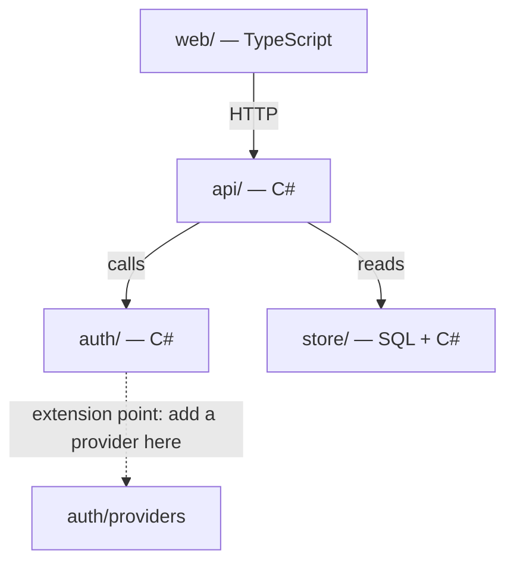

# Research and reuse

Research exists to answer one question before any Coder starts: **can the
need be met by extending code that already exists?** Reviewers block a
change that re-implements something the project has.

## 1. Documentation first

The Researcher reads, in this order, before searching for code:

1. **Documentation in the repository**: `README`, `docs/`, Markdown, LaTeX
   (`.tex`), reStructuredText, AsciiDoc, ADRs, changelogs, wiki exports,
   OpenAPI and schema files, runbooks.
2. **The project's instruction files**: `AGENTS.md`, `CLAUDE.md`,
   `.cursor/rules`, `.devops/project.md`.
3. **Documentation inside the code**: module and file header comments,
   docstrings and doc comments (rustdoc, Javadoc/JSDoc/TSDoc, XML docs,
   PEP 257 docstrings, Haddock, Doxygen...), `TODO` / `FIXME` / `NOTE`
   markers, and comments that link to external references. The profile's
   "Comments and documentation" section names the doc format per language.
4. **Tests**, which document intended behaviour.
5. Only then **online sources** (cite every URL with its date).

Prefer what the project already says about itself over what the web says
about the technology. Where docs and code disagree, say so in the brief; that
is a finding, not something to quietly resolve.

## 2. Map the modules (the mind map)

Every research brief carries a **module mind map**: a Mermaid diagram of the
modules the change could touch, how they depend on each other, and where
each could be extended. Build it from evidence, not memory: the MCP tool
`module_map` (or `devops-research module-map`) lists modules, languages and
the imports between them; add what you learn from the docs.



Mark with a dotted edge or a note: **extension points** (a registry, a
vtable, an interface, a plugin directory), **owners** (the module that must
own the new behaviour), and **forbidden edges** (a layer that must not
reach into another).

## 3. Double-check reuse

Before the brief is done, search for each noun and verb of the new concept:

- exact and near-exact names (`reuse_search` over the project, plus the
  language's own search),
- the same behaviour under another name (look at callers of the nearest
  neighbour),
- shared helpers, base classes, registries and generated clients,
- tests and fixtures that already exercise the behaviour.

Write the **reuse map**: what you searched (terms and paths), what you
found, and for each find one of **reuse as is**, **extend** (wrap, compose,
add an operation to the interface or driver), or **new, because …** with the
reason the existing code cannot be extended. Two functions never do the same
thing. If a shared helper is missing, add it once in a shared place and point
every caller at it.

## 4. Note the comment-worthy code

While reading, record where a comment *is* warranted in the area the Coder will
touch, so the Coder comments those places and no others:

- a non-obvious contract (units, ranges, errors, ordering, thread-safety);
- an invariant or constraint that another module relies on;
- a workaround for a bug or a platform quirk, with the issue it traces to;
- an algorithm or protocol taken from an outside source (record the link);
- a security-sensitive spot.

Also record existing comments that are **wrong, stale, restate the code or are
commented-out code** in that area, as candidates to delete (not as a license to
sweep unrelated files). List them by `path:line` with one clause each.

## 5. Brief template

```markdown
# Research: <topic>   Seat: <researcher-id>   Department: <dept>
## Docs read (path, what it says, any disagreement with the code)
## Module mind map (Mermaid) + extension points
## Reuse map (term | searched where | found | reuse / extend / new because)
## Comment-worthy code (path:line, why) and comments to delete (path:line, why)
## Options and recommendation (cited)
## Open questions for the human
```

The Coder may not start a department's work until this exists (new work),
and Reviewers cite it. A brief with no reuse map, or whose "new, because"
rows are not specific, is sent back by the Reviewer.
